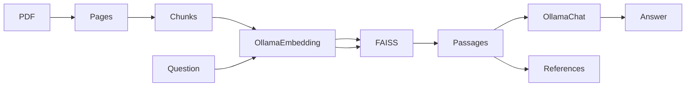

# Local PDF RAG pipeline

A small, fully local PDF retrieval-augmented generation demonstration. It extracts text with PyMuPDF, groups sections and simple table-like rows, embeds chunks using Ollama's `embeddinggemma`, searches normalized vectors using FAISS inner product, and asks `gemma3:4b` to answer from retrieved passages. The CLI returns retrieved source/page references and stage timings. This is a demonstration, not a production service.



## Quick path

Prerequisites: Python **3.12**, [uv](https://docs.astral.sh/uv/), [Ollama](https://ollama.com/) running on your own machine, and enough local resources for both models. No Ollama installation is needed for the offline tests.

```bash
uv sync --locked --dev
ollama pull embeddinggemma
ollama pull gemma3:4b
uv run --locked pdf-rag demo
uv run --locked pdf-rag ingest --pdf outputs/demo.pdf
uv run --locked pdf-rag chunk
uv run --locked pdf-rag index
uv run --locked pdf-rag retrieve "When should a backup be created?"
uv run --locked pdf-rag ask "When should a backup be created?"
uv run --locked pdf-rag evaluate --top-k 3
```

`demo` writes an independently authored two-page PDF to ignored `outputs/`. The other commands write extracted pages, chunks, a FAISS index, and an embedding-model manifest there. Retrieval prints passages with scores and one-based page numbers; `ask` prints an answer, retrieved references, and retrieval/generation timings. Answers and metric values vary with local models and are **not** asserted as benchmarks. Example: for the backup question, relevant evidence is on page 2 of `demo.pdf`; the model should describe the Friday schedule if it follows the supplied context. References identify retrieved passages, **not verified sentence-level citations**.

To ingest your own PDF, pass its path to `ingest --pdf`; use `--output`, `--pages`, `--chunks`, and `--index` to select local destinations. `--embedding-model` and `--chat-model` override the defaults. The Ollama client connects only to `127.0.0.1:11434`; it ignores `OLLAMA_HOST`, proxy settings, and ambient API credentials. PDFs must contain extractable text; OCR is not included. Treat local PDF, JSON, and FAISS files as sensitive. The ignore rules are not access controls: do not commit your corpus or share your local outputs.

`ingest` preserves extractable tab separators for the conservative table-row heuristic; it does not reconstruct PDF tables. `index --batch-size 32` (default) sends at most 32 chunks per local Ollama request. Section headings now contribute to embeddings while stored passage text stays original. Remove and rebuild older local indexes (manifest schema v2); the model tag alone does not identify a particular model binary.

## Verify without models

```bash
uv lock --check
uv sync --locked --dev
uv run --locked pre-commit run --all-files
uv run --locked pytest
uv run --locked python -m build
```

The tests mock Ollama; normal CI neither pulls models nor calls cloud services. `uv run --locked pdf-rag ...` needs the local Ollama daemon for `index`, `retrieve`, `ask`, and `evaluate`. If it is unavailable or models are missing, start the daemon and pull the named models. For missing input/index errors, run the preceding commands in order. For scanned PDFs, supply an independently OCR-processed text PDF. No cloud fallback, remote tracing, or default query log is provided. Retrieved documents can contain hostile instructions: passage delimiters and a system instruction reduce but cannot eliminate prompt-injection risk. Answers must be verified against the original document for important decisions.

## Structure and boundaries

`src/local_pdf_rag_pipeline/` holds the CLI and pipeline stages; `tests/` exercises offline behavior; `examples/` contains only newly authored labels; `docs/ARCHITECTURE.md` details interfaces; `docs/FUTURE_IMPROVEMENTS.md` lists unimplemented ideas. Generated PDF, page JSON, chunk text, index, and metadata remain in ignored `outputs/` and are never shipped. This package has no license grant at present; see `CONTRIBUTING.md` before reusing or contributing code. Security reports: `SECURITY.md`.
