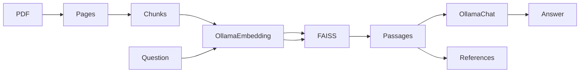

# Local PDF RAG pipeline

A small, fully local PDF retrieval-augmented generation demonstration. It extracts text with PyMuPDF, groups sections and simple table-like rows, embeds chunks using Ollama's `embeddinggemma`, searches normalized vectors using FAISS inner product, and asks `gemma3:4b` to answer from retrieved passages. The CLI returns retrieved source/page references and stage timings. This is a demonstration, not a production service.



## Quick path

Prerequisites: Python **3.12**, [uv](https://docs.astral.sh/uv/) (0.12.9 is known to work), [Ollama](https://ollama.com/) running on your own machine, and enough local resources for both models. No Ollama installation is needed for the offline tests. Run these commands from a clean checkout:

```bash
uv lock --check
uv sync --locked --dev
ollama pull embeddinggemma
ollama pull gemma3:4b
uv run --locked pdf-rag demo
uv run --locked pdf-rag ingest --pdf outputs/demo.pdf
uv run --locked pdf-rag chunk
uv run --locked pdf-rag index
uv run --locked pdf-rag retrieve "When should a backup be created?"
uv run --locked pdf-rag ask "When should a backup be created?"
uv run --locked pdf-rag evaluate --top-k 3
```

`demo` writes an independently authored three-page PDF to ignored `outputs/`. The other commands write extracted pages, chunks, a FAISS index, and an embedding-model manifest there. Retrieval prints passages with scores and one-based page numbers; `ask` prints an answer, retrieved references, and retrieval/generation timings. Answers and metric values vary with local models and are **not** asserted as benchmarks. Example: for the backup question, relevant evidence is on page 2 of `demo.pdf`; the model should describe the Friday schedule if it follows the supplied context. References identify retrieved passages, **not verified sentence-level citations**. Five labeled synthetic retrieval cases include a heading-only term and an unsupported question; no real-corpus quality score is claimed.

To ingest your own PDF, pass its path to `ingest --pdf`; use `--output`, `--pages`, `--chunks`, and `--index` to select local destinations. `--embedding-model` and `--chat-model` override the defaults. The Ollama client connects only to `127.0.0.1:11434`; it ignores `OLLAMA_HOST`, proxy settings, and ambient API credentials. PDFs must contain extractable text; OCR is not included. Treat local PDF, JSON, and FAISS files as sensitive. The ignore rules are not access controls: do not commit your corpus or share your local outputs.

`ingest` preserves extractable tab separators for the conservative table-row heuristic; it does not reconstruct PDF tables. `index --batch-size 32` (default) sends at most 32 chunks per local Ollama request. Section headings now contribute to embeddings while stored passage text stays original. Remove and rebuild older local indexes (manifest schema v2); the model tag alone does not identify a particular model binary.

## Reproducibility and limits

`uv.lock` fixes the Python dependency resolution, **not** model outputs. CI uses Python 3.12.14 and uv 0.12.9 on `ubuntu-latest`; that runner image can change, and local FAISS/OS/hardware, Ollama runtime, model weights and generated text can differ. A model tag such as `embeddinggemma` is mutable. The index manifest records the tag, dimension and corruption checksums, **not** an immutable Ollama model digest. Before comparing local runs, record the local server version and model digests in ignored files:

```bash
mkdir -p outputs
curl --noproxy '*' --fail --silent --show-error http://127.0.0.1:11434/api/version > outputs/ollama-version.json
curl --noproxy '*' --fail --silent --show-error http://127.0.0.1:11434/api/tags > outputs/ollama-model-tags.json
```

Check the `digest` for `embeddinggemma` and `gemma3:4b` in `models` locally; never commit the inventory. Rebuild an index if the embedding binary changes even when the tag is unchanged. Metrics refer only to five independently authored synthetic labels, not general retrieval performance. There is no deployment, cloud fallback, OCR, claim-level citation verification, or production security guarantee. No raw-query log is written by default.

## Verify without models

```bash
uv lock --check
uv sync --locked --dev
uv run --locked pre-commit run --all-files
uv run --locked pytest
uv run --locked python -m build
uv audit --locked
uv run --locked python scripts/check_repository.py --history
```

The tests mock Ollama; normal CI neither pulls models nor calls cloud services. CI requires `locked-offline-quality`, `locked-dependency-audit`, and `locked-publication-security` (tracked/history policy plus SHA-256-verified, redacted Gitleaks). It neither uploads corpus artifacts/caches nor proves real-model answer quality. A high coverage percentage measures exercised Python branches, not privacy, PDF parser safety or factual correctness. Optional real-model checks run only on your local synthetic PDF. Retrieved documents can contain hostile instructions: JSON-encoded reference data, a separate user question and a system instruction reduce ambiguity but cannot guarantee prompt-injection resistance. Verify important answers against the original document.

| Symptom | Local action |
| --- | --- |
| Ollama connection or model missing | Run Ollama locally, then pull the two named models; no remote fallback exists. |
| Missing PDF, JSON or index | Run `demo`/`ingest`/`chunk`/`index` in order and check the local paths. |
| Corrupted or old index | Remove only your generated `outputs/index` and rebuild with `index`; never load an index from an untrusted source. |
| Image-only or unsupported PDF | Independently OCR-process it to a text PDF first; OCR is not included. |
| Input/resource limit reached | Use smaller local documents or adjust `ingest --max-pdf-mb`, `--max-pages`, `--max-text-chars`, `chunk --max-chunks` and `index --batch-size` within documented hard bounds. |

## Structure and boundaries

`src/local_pdf_rag_pipeline/` holds the CLI and pipeline stages; `tests/` exercises offline behavior; `examples/` contains only newly authored labels; `docs/ARCHITECTURE.md` details interfaces; `docs/FUTURE_IMPROVEMENTS.md` lists unimplemented ideas. Generated PDF, page JSON, chunk text, index, and metadata remain in ignored `outputs/` and are never shipped. This package has no license grant at present; see `CONTRIBUTING.md` before reusing or contributing code. Security reports: `SECURITY.md`.
